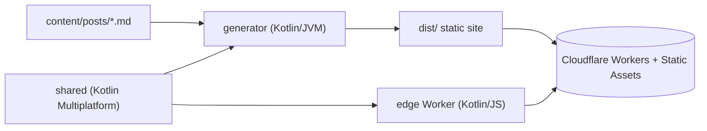

# dimaruns.nl

Personal website and blog. The site is generated by a static-site generator written in Kotlin and served from the edge on Cloudflare Workers.



## Modules

| Module | Purpose |
|---|---|
| `build-logic/` | Gradle convention plugins (`dimaruns.kotlin-jvm`, `dimaruns.kotlin-multiplatform`, `dimaruns.quality`) |
| `shared/` | Post model, front-matter schema, slug rules and validation, compiled for JVM and JS |
| `generator/` | JVM CLI that turns Markdown into the static site |
| `edge/` | *(planned)* Cloudflare Worker for dynamic features |

## Development

Requires JDK 21. Everything else (Gradle, Node.js for the JS tests) is downloaded by the build.

```sh
./gradlew build             # compile, ktlint, tests on JVM + JS, Kover coverage
./gradlew ktlintFormat      # auto-format
./gradlew :generator:run    # run the generator against content/posts
```

The build uses the configuration cache and build cache. All repositories are declared in `settings.gradle.kts`, and modules cannot add their own.

## License

[MIT](LICENSE)
