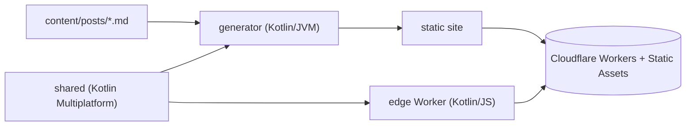

# dimaruns.nl

Personal website and blog. The site is generated by a static-site generator written in Kotlin and served from the edge on Cloudflare Workers.



## Modules

| Module | Purpose |
|---|---|
| `build-logic/` | Gradle convention plugins (`dimaruns.kotlin-jvm`, `dimaruns.kotlin-multiplatform`, `dimaruns.quality`) |
| `shared/` | Post model, front-matter schema, slug rules and validation, compiled for JVM and JS |
| `generator/` | JVM CLI that turns Markdown into the static site |
| `edge/` | *(planned)* Cloudflare Worker for dynamic features |
| `infra/` | OpenTofu: Cloudflare zone, DNS, D1/KV/R2 ([details](infra/README.md)) |

## Development

Requires JDK 21. Everything else (Gradle, Node.js for the JS tests) is downloaded by the build.

```sh
./gradlew build                            # compile, ktlint, tests on JVM + JS, Kover coverage, render the site
./gradlew ktlintFormat                     # auto-format
./gradlew :generator:generateSite          # render into generator/build/site
./gradlew :generator:serveSite             # render and preview on http://localhost:8080
./gradlew :generator:serveSite -Pdrafts=true
./gradlew :generator:generateSite -PbaseUrl=https://preview.example.dev
```

The build uses the configuration cache and build cache. All repositories are declared in `settings.gradle.kts`, and modules cannot add their own. `generateSite` declares its inputs and outputs, so it is skipped when content hasn't changed and can be restored from the build cache.

## Writing posts

Add a Markdown file to `content/posts/`:

```markdown
---
title: My Post            # required
date: 2026-11-23          # required, ISO date
summary: One-liner        # optional; defaults to the first paragraph
tags: [kotlin, edge]      # optional; lowercase-kebab-case
slug: custom-url          # optional; defaults to the title, e.g. my-post
draft: true               # optional; excluded unless -Pdrafts=true
---

Markdown body (CommonMark + GFM tables, strikethrough, autolinks).
```

Invalid content fails the build with every problem listed at once. Raw HTML in posts is escaped and `javascript:` links are dropped, so the site can use a strict Content-Security-Policy.

Site-wide settings live in `content/site.yaml`. Static files in `static/` are copied to the output as they are.

## Output

| Path | Content |
|---|---|
| `/` | Post list, newest first |
| `/posts/<slug>/` | Post page |
| `/tags/`, `/tags/<tag>/` | Tag index and per-tag lists |
| `/feed.xml` | Atom feed (latest 20 posts, full content) |
| `/sitemap.xml`, `/robots.txt`, `/404.html` | For crawlers and missing pages |

## License

[MIT](LICENSE)
